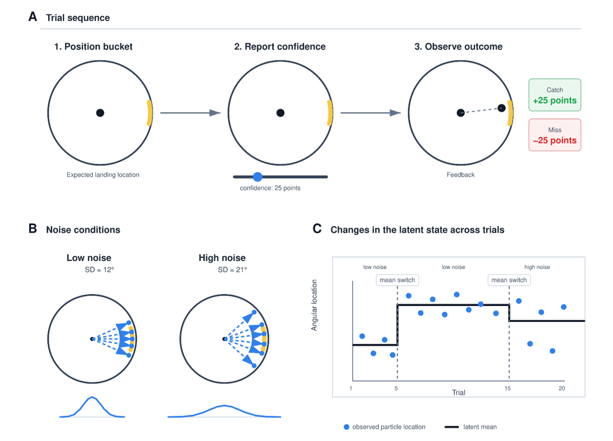

# Certain Minds in an Uncertain World? Exploring Computational Signatures of Belief Updating in Individuals Holding Radical Attitudes

[](https://doi.org/10.5281/zenodo.XXXXXXX)

Analysis code and data for the study **"Certain Minds in an Uncertain World? Exploring Computational Signatures of Belief Updating in Individuals Holding Radical Attitudes"** (Knorr, Podolin, Starlinger, Kossowska & Mikuš).

- Preprint: TODO (PsyArXiv link / DOI)
- Paper: TODO (journal DOI, after publication)
- Task software: see [Task software](#task-software) (the task code is not part of this release)

## Overview

We tested how two dimensions of radical political attitudes, dogmatic intolerance and authoritarianism, relate to learning under uncertainty in a politically neutral predictive-inference task. 462 US adults (recruited via Prolific) were analysed. They completed 300 trials of a predictive-inference task in which they positioned a bucket to catch a particle, reported their confidence of catching it, and received feedback. Observational noise and occasional changes of the latent mean were manipulated.

The analyses cover:

- exploratory factor analysis of the attitude measures (dogmatic intolerance, authoritarianism, political orientation),
- model-agnostic behaviour: mean inference, learning rate, confidence, metacognitive sensitivity and calibration,
- computational modelling with the extended hierarchical Gaussian filter of [Mikuš et al. (2025)](https://doi.org/10.1016/j.biopsych.2024.08.021), and its association with radical attitudes.

## Task settings

<p align="center"></p>

*Predictive-inference task and generative structure.*

The task was a browser-based predictive-inference task.

| Setting | Value | Configuration key |
|---------|-------|-------------------|
| Trials | 300 (3 blocks of 100) | `numBlocks`, `numTrialsPerBlock` |
| Bucket size | 36° (fixed) | `bucketMaxSize`, `bucketSizeStatic` |
| Observational noise (SD of particle landing location) | 12° (low noise), 21° (high noise) | `stdDefault`, `stdVolatile` |
| Probability of a change in the latent mean (per eligible trial) | .10 | `probMeanChange` |
| Minimum trials between mean changes | 3 | `minTrialsNoMeanChange` |
| Minimum distance of a new mean from the previous mean | 12° | `minDiffNewMean` |
| Probability that the noise level switches at a mean change | .40 | `probStdChange` |
| Confidence scale | 5–100%, steps of 5 | |

Further configuration values: `maxNoChangeCount` = 30, `slowTrialCount` = 5, `slowTrialTimeout` = 15.

## Repository structure

```
.
|-- CITATION.cff
|-- LICENSE                                  # MIT (code)
|-- README.md
|-- code/
|   |-- R/                                   # R project root (renv); run all R code from here
|       |-- Analysis.Rproj
|       |-- .Rprofile                        # activates renv
|       |-- renv.lock                        # package versions
|       |-- renv/                            # renv setup
|       |-- 01 Preprocessing.qmd             # raw (pseudonymised) exports
|       |-- 02 Data Checks.Rmd               # data quality checks
|       |-- 03 Descriptives.Rmd              # descriptive statistics
|       |-- 04 Factor and composite scores.Rmd   # scale composites, factor analysis
|       |-- 05 Main analyses.Rmd             # behavioural and HGF analyses
|       |-- helper_functions.R               # helper functions, including run_models()
|       |-- models/
|           |-- ehgf_jget_full.stan          # Stan implementation of the extended HGF
|           |-- ModelEstimationWrapper.R     # fits the model to the trial-level data
|-- data/
    |-- LICENSE.md                           # CC BY 4.0 (data)
    |-- L122136/
        |-- experiment_results.csv       # raw task export (pseudonymised)
        |-- questionnaire_data.csv       # raw questionnaire export (pseudonymised, free text removed)
        |-- mood_data.csv                # raw in-task mood ratings (pseudonymised)
        |-- cleaned/
            |-- modelling_data.csv           # trial-level task data
            |-- composites_data.csv          # participant-level attitude composites, factor scores, demographics
            |-- HGF_Model_output.csv         # fitted HGF parameters per participant
            |-- Ehgf_taskData2.csv           # HGF belief trajectories per trial
            |-- task_clean.csv               # cleaned task data (output of script 01)
            |-- questionnaire_clean.csv      # cleaned questionnaire data (output of script 01)
            |-- mood_clean.csv               # cleaned mood ratings (output of script 01)
```

## Data

All files needed to rerun the analyses are shared: raw exports (in `data/L122136/`), cleaned files (in `data/L122136/cleaned/`) and analysis files. Free-text answers were removed (the column `feedback` in the questionnaire files is empty). Participant identifiers were replaced by random study IDs: `S001`, `S002`, ... for the 467 participants in the cleaned data and `X0001`, `X0002`, ... for participants who did not complete the study or were excluded (they appear only in the raw files; script `01` applies the exclusions). The IDs are consistent across all files; Prolific IDs are not included and the mapping is not published.

| File | Level | Participants | Rows | Content |
|------|-------|--------------|------|---------|
| `modelling_data.csv` | trial | 467 | 297 per participant | task variables and responses, plus derived variables used for modelling |
| `composites_data.csv` | participant | 462 | 1 per participant | attitude scale composites and factor scores, demographics |
| `HGF_Model_output.csv` | participant | 467 | 1 per participant | fitted HGF parameters |
| `Ehgf_taskData2.csv` | trial | 467 | 297 per participant | task data and HGF belief trajectories |
| `experiment_results.csv` | event | 748 | 185,600 in total | raw task export, including participants who did not complete the study or were excluded |
| `questionnaire_data.csv` | participant | 972 | 979 in total | raw questionnaire export, including participants who did not complete the task |
| `mood_data.csv` | rating | 774 | 7,781 in total | raw in-task mood ratings |
| `task_clean.csv` | trial | 467 | 140,100 in total | cleaned task data after exclusions (output of script `01`) |
| `questionnaire_clean.csv` | participant | 467 | 1 per participant | cleaned questionnaire data after exclusions (output of script `01`) |
| `mood_clean.csv` | rating | 467 | 5,616 in total | cleaned mood ratings (output of script `01`) |

### Participants and trials

- **Trials:** The task had 300 trials (3 blocks of 100). In the trial-level files the last trial of each block (`ID` = 100) is removed, because no `action` (the change of the bucket position to the next trial) can be computed for it. Every participant therefore has 3 x 99 = 297 trials, and `ID` runs from 1 to 99 within each block.
- **Participants:** The trial-level files and the HGF file contain 467 participants. `composites_data.csv` contains the 462 participants analysed in the paper. The five additional participants (`S114`, `S191`, `S216`, `S301`, `S415`) have task data but no attitude composites, because the composites were computed for complete cases only (see `code/R/04 Factor and composite scores.Rmd`). They are not part of the analyses.
- **Primary analyses:** The primary models adjust for age, gender and education and use N = 448, because participants who selected "Other" or did not disclose their gender are excluded from them.

### Variables

`modelling_data.csv` (and, with HGF additions, `Ehgf_taskData2.csv`):

| Variable | Description |
|----------|-------------|
| `subject_id` | pseudonymous participant ID (`S001`, ...), used to join the files |
| `Stage` | task block (0, 1, 2) |
| `ID` | trial number within the block (1-99, see above) |
| `Mean` | true latent mean of the generative distribution (degrees) |
| `Angle` | particle landing location (degrees) |
| `Bucket.Position` | participant's bucket position (degrees), as recorded by the task; called `Bucket_Position` in `Ehgf_taskData2.csv` |
| `Caught` | 1 = particle caught, 0 = missed |
| `Noise_Condition` | `Low_Noise` (SD = 12°) or `High_Noise` (SD = 21°) |
| `conf` | confidence of catching the particle (5-100%, steps of 5), reported on the **next** trial (t + 1), so that it is aligned with `pe` and `action` of trial t |
| `pe` | absolute prediction error: circular distance between the bucket position and the particle landing location (degrees) |
| `action` | absolute update: circular distance between the bucket position on the next trial and on the current trial (degrees) |
| `pe_sc`, `action_sc`, `conf_sc` | variable scaled within participant |
| `ranked_PE`, `ranked_action`, `ranked_conf` | variable rank-transformed within participant |
| `pe_rank_sc`, `action_rank_sc`, `conf_rank_sc` | rank-transformed variable, scaled within participant |

The learning rate used in the analyses is `action / pe` (trials with `pe` = 0 are excluded), as described in the paper.

`Ehgf_taskData2.csv` additionally contains the belief trajectories of the HGF (notation as in the paper):

| Variable | Description |
|----------|-------------|
| `mux1`, `mux2`, `mua` | belief means about the latent mean, the environmental volatility and the observational noise |
| `lr1`, `lr2`, `lra` | the corresponding learning rates (update weights) |
| `sax1`, `sax2`, `saa` | the corresponding belief uncertainties (variances) |

`HGF_Model_output.csv` (one row per participant):

| Variable | Description |
|----------|-------------|
| `ID` | study ID, corresponds to `subject_id` |
| `om` | tonic volatility (ω) |
| `om2` | environmental volatility (ϑ) |
| `oma` | variance volatility (ωα) |
| `noise` | decision noise (η, log scale) |

`composites_data.csv`:

| Variable | Description |
|----------|-------------|
| `subject_id` | pseudonymous participant ID |
| `age`, `gender`, `education` | demographics |
| `lc_gen`, `lc_eco`, `lc_soc` | self-reported political orientation (overall, economic, social) from 0 (liberal) to 100 (conservative) |
| `demo_id`, `repub_id` | identification with the values and goals of the Democratic / Republican Party, from 1 (not at all) to 7 (very much) |
| `DOG`, `RWA`, `LWA`, `SECS`, `PI`, `BS`, `LC`, `CM`, `IUS` | mean scores of the scales: dogmatism (DOG), right-wing authoritarianism (RWA), left-wing authoritarianism (LWA), Social and Economic Conservatism Scale (SECS), political issue positions (PI), belief superiority (BS), liberal-conservative self-placement (LC; mean of `lc_gen`, `lc_eco`, `lc_soc`), conspiracy mentality (CM), intolerance of uncertainty (IUS, 12 items) |
| `FA_PO`, `FA_DOG`, `FA_AUTH` | factor scores for political orientation, dogmatic intolerance and authoritarianism |

## Reproducing the analyses

Requirements: R 4.5.0 and the package versions recorded in `code/R/renv.lock`.

1. Clone or download this repository.
2. Start R in the folder `code/R/` (for example by opening `Analysis.Rproj` in RStudio), so that `renv` activates.
3. Install the packages with `renv::restore()`.
4. Open `05 Main analyses.Rmd` and knit it, or run all chunks from the top. The chunks depend on each other (the data are loaded in the first chunks), so run them in order. Data paths are relative (`../../data/...`), so run the file from `code/R/`, which is the default when knitting.

Scripts `01` to `05` can all be run from the shared files. Run them in numerical order: `01` reads the raw exports and writes the cleaned files, `02` to `04` check and describe the data and compute the composite and factor scores, and `05` runs the main analyses. Script `04` takes about 25 minutes.

Main packages: `tidyverse`, `lme4`, `lmerTest`, `parameters`, `effectsize`, `Hmisc`, `HLMdiag`.

**HGF estimation.** The HGF parameters were estimated with a hierarchical Bayesian implementation of the extended HGF in Stan (`code/R/models/ehgf_jget_full.stan`), which is fitted from R with `code/R/models/ModelEstimationWrapper.R` (function `run_model_fit()`, based on hBayesDM, using the package `rstan`). Sampling settings in the wrapper: 4 chains, `nIter` iterations per chain (default 2000), warm-up of one third of the iterations, `adapt_delta` = 0.95, `max_treedepth` = 17, seed 1450154637. The shared files `HGF_Model_output.csv` and `Ehgf_taskData2.csv` contain the resulting estimates. The estimation code is included for transparency.

## Task software

The task was implemented as a web application hosted on Firebase, built by Ferdinand Wittmann and adapted from the predictive-inference task of [Seow & Gillan (2020)](https://www.nature.com/articles/s41598-020-59646-4) (original code: https://github.com/seowxft/predictive-inference-task, CC BY-NC 4.0; a lab version was originally provided by Vaghi et al., 2017). The task software is not part of this release: this repository contains the analysis code and the data only. The design and the settings needed to describe the task are given above and in the paper.

## Citation

If you use this code or data, please cite the archived version on Zenodo
(DOI: 10.5281/zenodo.XXXXXXX) and the associated paper. Citation metadata
is also provided in CITATION.cff.

## License

- Code: MIT License (see `LICENSE`).
- Data (`data/`): Creative Commons Attribution 4.0 International, CC BY 4.0 (see `data/LICENSE.md`).

This repository contains no third-party datasets.

## Contact

Anna Knorr, Institute of Psychology, Jagiellonian University, Krakow, Poland. anna.knorr@uj.edu.pl
